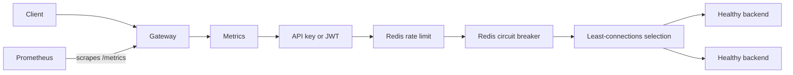

# API Gateway

A Go HTTP gateway for routing requests to healthy backends. It combines API key and JWT authentication, Redis-backed rate limiting and circuit breaking, least-connections load balancing, live configuration reloads, and Prometheus metrics.

## Run locally

The quickest way to try the gateway is with Docker Compose. It starts the gateway, three demo backends, Redis, Prometheus, and Grafana.

```bash
export JWT_SECRET="$(openssl rand -hex 32)"
export API_KEYS="$(openssl rand -hex 32)"
export REDIS_PASSWORD="$(openssl rand -hex 32)"
export GF_SECURITY_ADMIN_PASSWORD="$(openssl rand -hex 32)"

docker compose up -d --build
```

Send an authenticated request and check gateway health:

```bash
curl -i -H "X-API-KEY: ${API_KEYS}" http://localhost:8080/users
curl -i http://localhost:8080/healthz
curl -i http://localhost:8080/readyz
```

The demo route `/users` balances traffic between backend 1 and backend 3. Open Prometheus at [localhost:9090](http://localhost:9090) or Grafana at [localhost:3000](http://localhost:3000) (login: `admin` and the password in `GF_SECURITY_ADMIN_PASSWORD`). Services bind to loopback on your machine.

Stop the stack with `docker compose down`. Add `-v` to also delete the local data volumes.

## Request flow

The first middleware listed in a service configuration wraps the rest. The shipped order is:

```text
metrics → authentication → rate limit → circuit breaker → healthy backend
```



Metrics wraps authentication so rejected requests are counted. Authentication runs before rate limiting so unauthenticated clients cannot consume another identity's bucket. Health checks run before the gateway starts serving and before a new configuration is published.

## What it does

- **Authentication:** API keys from `X-API-KEY` or JWT bearer tokens. JWTs must use HS256 and include a valid expiration claim. Issuer and audience checks are optional. Subject-less JWTs use a token-derived identity.
- **Rate limiting:** Redis Lua token bucket shared by gateway instances. Limits are keyed by identity and route. Redis uses its own clock; on Redis errors, the gateway allows traffic and increments an error metric.
- **Circuit breaking:** Redis-backed closed, open, and half-open states. A single owned probe is admitted in half-open state; stale outcomes cannot overwrite newer state. Redis errors fail open.
- **Backend selection:** Least active connections among healthy backends, with rotating tie breaks. Routes match complete path segments (`/users` matches `/users/123`, not `/usersXYZ`).
- **Health and readiness:** Backend health is checked at `<backend-base-path>/health`. `/healthz` reports process liveness; `/readyz` reports whether every configured service has a healthy backend and the gateway is not draining.
- **Configuration reload:** The config file is checked every two seconds. Validated settings and routes are published as one snapshot; in-flight requests finish on their original snapshot.
- **Operations:** `/version`, `/metrics`, graceful SIGTERM shutdown, and optional pprof profiling. Profiling is off by default.

## Configure a service

The example config is [`config.yaml`](config.yaml). A minimal service entry looks like this:

```yaml
port: ":8080"
jwt_secret: "" # Set JWT_SECRET to a random value of at least 32 bytes.

redis:
  addr: "localhost:6379"

middleware_config:
  auth_apikey:
    valid_keys: [] # Set API_KEYS or provide keys here.

services:
  - name: users
    route_pattern: "/users"
    urls:
      - "http://localhost:8081"
      - "http://localhost:8083"
    middleware:
      - "metrics"
      - "auth_apikey"
      - "rate_limit"
      - "circuit_breaker"
    rate_limit_rps: 200
    rate_limit_burst: 400
    cb_failure_threshold: 6
    cb_reset_timeout_seconds: 15
```

| Setting | Meaning | Default |
|---|---|---:|
| `port` | Gateway listen address | `:8080` |
| `jwt_secret` | Required HS256 secret; minimum 32 bytes | none |
| `jwt_issuer`, `jwt_audience` | Expected JWT claims, when set | unset |
| `redis.addr`, `redis.password`, `redis.db` | Redis connection settings | `localhost:6379`, empty, `0` |
| `route_pattern` | Clean absolute path; longest matching route wins | required |
| `urls` | One or more HTTP(S) backend base URLs | required |
| `middleware` | Supported middleware names, outermost first | none |
| `rate_limit_rps`, `rate_limit_burst` | Token refill rate and bucket capacity | `100`, `200` |
| `cb_failure_threshold`, `cb_reset_timeout_seconds` | Failures to open and delay before probing | `5`, `10` |

Unknown middleware, malformed routes or backend URLs, duplicate names/routes, negative or non-finite limits, and invalid JWT secrets are rejected. Backend URLs cannot include credentials, query strings, or fragments.

Environment variables override file values: `CONFIG_PATH`, `PORT`, `JWT_SECRET`, `JWT_ISSUER`, `JWT_AUDIENCE`, `API_KEYS` (comma-separated), `REDIS_ADDR`, `REDIS_PASSWORD`, `REDIS_DB`, `PPROF_ADDR`, and `SHUTDOWN_DELAY`. Compose requires `JWT_SECRET`, `API_KEYS`, `REDIS_PASSWORD`, and `GF_SECURITY_ADMIN_PASSWORD`.

### Run without Compose

Install Go 1.26 or newer and Redis. Run Redis and each backend in its own terminal. Set these values in the terminal where you launch the gateway:

```bash
export JWT_SECRET="$(openssl rand -hex 32)"
export API_KEYS="$(openssl rand -hex 32)"
```

Start Redis:

```bash
redis-server
```

Start the demo backends in separate terminals:

```bash
go run ./cmd/backend1
```

```bash
go run ./cmd/backend2
```

```bash
go run ./cmd/backend3
```

Start the gateway:

```bash
go run ./cmd/gateway
```

The gateway reads `config.yaml` by default. `CONFIG_PATH=/path/to/config.yaml` selects another file.

## Check and build

```bash
make ci       # tests, lint, config validation, Go and Docker builds
make cd       # disposable kind deployment and end-to-end smoke checks
make cd-down  # remove the test cluster created by make cd
```

`make ci` requires Go, Docker, kubectl, yamllint, and golangci-lint. `make cd` also requires kind and uses the separate `api-gateway-e2e` cluster. It does not deploy to a remote cluster. For focused Go checks:

```bash
go test -race -count=1 -cover ./...
go vet ./...
```

The test suite uses miniredis and httptest; Go tests do not require external Redis or backends. The CI workflow runs on pushes and pull requests. See [`.github/workflows/ci.yml`](.github/workflows/ci.yml).

## Metrics and profiling

`GET /metrics` exposes Prometheus metrics, including:

- `http_request_counter{method,status,service}`
- `http_request_timer` (request duration in seconds)
- `gateway_rate_limited_total{service}` (rejections only)
- `gateway_redis_operation_errors_total{service,operation}`
- `gateway_circuit_breaker_state{service}` (`0` closed, `1` open, `2` half-open)
- `gateway_proxy_canceled_total`

Example PromQL:

```promql
rate(http_request_counter[5m])
histogram_quantile(0.95, sum(rate(http_request_timer_bucket[5m])) by (le))
sum(rate(gateway_rate_limited_total[5m])) by (service)
```

`/metrics` is unauthenticated. Kubernetes NetworkPolicies limit access to the monitoring and ingress namespaces; do not expose the endpoint publicly. To enable pprof for local profiling, bind it to loopback:

```bash
PPROF_ADDR=127.0.0.1:6060 go run ./cmd/gateway
```

## Kubernetes and other deployment options

For a disposable local Kubernetes test, use `make cd` and `make cd-down`. For a persistent local kind cluster, run `make kind-up`, `make deploy`, and `make smoke`; see [`docs/DEVOPS.md`](docs/DEVOPS.md) for Compose, Kubernetes overlays, Terraform, Ansible, and operational instructions.

The production overlay requires a pre-created secret. Use a versioned release or SHA image tag for production, and never use example credentials in a deployed environment. The manifests include probes, resource settings, NetworkPolicies, a PDB, and a Redis StatefulSet intended for local or kind use.

## Limitations

- Rate limiting and circuit breaking fail open when Redis is unavailable. The included Redis deployment is a single replica; use managed or highly available Redis for production.
- Least-connections counts are local to each gateway instance. Circuit-breaker state is per route, not per backend. Its metric may be stale while Redis is unavailable.
- Client IP fallback uses the TCP peer address. Forwarded headers are ignored, so clients behind the same proxy may share a rate-limit identity.
- The gateway does not terminate TLS; use an ingress, load balancer, or service mesh. JWT support is symmetric HS256 only.
- `/metrics` has no application authentication. pprof has no authentication and must remain disabled or privately reachable.
- The proxy has dial, TLS-handshake, and response-header timeouts, but no overall request deadline so long-running responses can stream. Kubernetes ingress applies its own body-size limit; the gateway itself does not set a global request-body limit.
- `wrk_60s.txt` is a historical benchmark artifact, not a reproducible performance claim. Re-run and document the environment before citing throughput numbers.

## More information

- [Development and deployment runbook](docs/DEVOPS.md)
- [Manual verification checklist](docs/MANUAL_TEST_CHECKLIST.md)
- [Dev Container setup](docs/DEVCONTAINER.md)
- [Example gateway configuration](config.yaml)

Built by [Mohd Kamaal](https://github.com/Mohdcode).
